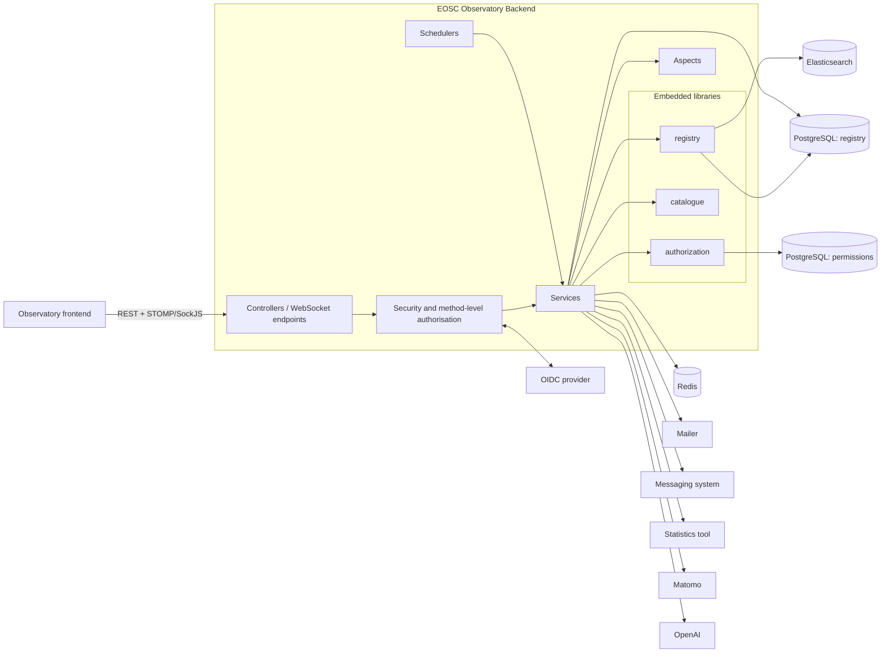

# EOSC Observatory Backend — Architecture

File-level evidence is listed in the [evidence index](#evidence-index).

## Purpose and scope

The EOSC Observatory Backend is a Spring Boot monolith that exposes the REST and WebSocket APIs used by
the Observatory frontend.

**Responsibilities**

- Survey lifecycle: survey models, survey answers, validation, locking, versioning/history and diffs,
  CSV import/export.
- Organisation model: administrators, coordinators and stakeholders (country and association types),
  with their members, managers and contributors; invitations.
- Users: profiles, settings, notification preferences, privacy-policy acceptance.
- Authorisation: roles, per-resource permissions on survey answers, method-level security.
- Collaboration: real-time presence and concurrent-edit signalling, survey-answer comment threads,
  inbox-style messaging.
- Dashboards (widget defaults per dashboard code and stakeholder type, with per-stakeholder
  overrides), news items, external datasets.
- GDPR user erasure: purge of a user's data across the registry, version history, comments and the
  messaging service, recorded in an erasure register (see [user-erasure.md](user-erasure.md)).
- Documents referenced by survey answers: URL extraction, AI-assisted generation, review status,
  recommendations.
- Survey lifecycle email notifications.
- Proxying of the statistics tool and Matomo analytics.

**Non-responsibilities**

- Identity management and authentication: delegated to an external OIDC provider.
- Email delivery and the messaging store: delegated to the mailer and messaging-system services.
- User interface: provided by the separate frontend.
- Statistics computation: performed by the statistics tool.
- The generic resource store, form/model engine and permission engine are libraries owned by the
  `registry`, `catalogue` and `authorization` projects.

## Component diagram

Source: [diagrams/component-diagram.mmd](diagrams/component-diagram.mmd)

## Modules

All application code lives under `eu.openaire.observatory`.

| Module (package) | Responsibility |
|---|---|
| `controller` | REST controllers for administrators, coordinators, stakeholders, surveys and answers, users, dashboards, news, groups, permissions, privacy policies, invitations, CSV, CSRF token, analytics. Shared CRUD base class and exception/privacy advices. |
| `service` | Business logic and persistence orchestration on top of the registry: CRUD services per resource type, survey and answer handling, history/diff, invitations (encrypted tokens), survey email notifications, user purge and erasure register, Redis-backed cache. |
| `domain`, `dto`, `mappers` | Registry-persisted domain types (`Stakeholder`, `Coordinator`, `Administrator`, `SurveyAnswer`, `User`, ...), API DTOs, MapStruct mappers. |
| `configuration` | Application, async, Redis, OpenAPI, CORS, mailer and privacy configuration. `configuration.security` holds the OIDC login, CSRF and method-security setup. `configuration.logging` masks erased users in logs. |
| `permissions` | Bridge to the `authorization` library and the permission/group vocabulary. |
| `aspect` | AOP hooks: grant/revoke answer permissions on create/delete, update the user record on login, add human-readable labels to survey-answer facets, and block group writes while a user purge runs. |
| `websockets` | STOMP endpoint, presence tracking, concurrent-edit notifications, live survey-answer comments. |
| `commenting` | Comment threads on survey answers (own JPA datasource, schema `commenting`) and notifications. |
| `messaging` | Integration with the messaging system: inbox/outbox controller, unread counters, email fan-out to group members. `messaging.mailer` holds `ResilientMailer`, the HTTP client for the mailer. |
| `erasure` | Erasure register entity and its own JPA datasource (schema `erasure`). |
| `widget` | Dashboard codes, widget defaults and overrides. |
| `resources` | Documents derived from survey answers: URL extraction, AI generation, status workflow, recommendations, CSV conversion. |
| `datasets` | Uploaded external datasets (own JPA datasource, schema `external_datasets`) and ingest services. |
| `statistics` | Proxy to the statistics tool with per-query access rules. |
| `utils` | JSON, user-id and email-masking helpers. |

Resource types persisted through the registry are declared as JSON schemas in
`src/main/resources/resourceTypes/` and created on startup
(`registry.resource-type-init.location`): `administrator`, `coordinator`, `stakeholder`, `user`,
`survey_answer`, `survey_settings`, `news_item`, `document`, `privacy_policy`, `dashboard_defaults`,
`dashboard_overrides`, `stakeholder_indicators`. No code reads `stakeholder_indicators` any more. Email templates are FreeMarker files in `src/main/resources/templates/emails/`.

## Persistence

| Store | Used for |
|---|---|
| PostgreSQL `registry` database (`registry.datasource.*`) | Registry resources and versions. Schema validated at startup (`hbm2ddl.auto=validate`). |
| PostgreSQL schema `commenting` (default URL: `registry` database) | Comment threads and messages. Schema managed by Hibernate (`update`). |
| PostgreSQL schema `external_datasets` (default URL: `registry` database) | External dataset entries. Schema managed by Hibernate (`update`). |
| PostgreSQL schema `erasure` (default URL: `registry` database) | Erasure register: one row per purge attempt. Schema managed by Hibernate (`update`). |
| PostgreSQL `permissions` database (`authorization.datasource.*`) | Subject/action/object permission records. Schema managed by Hibernate (`update`). |
| Elasticsearch (`registry.elasticsearch.*`) | Search index over registry resources, used for filtering and facets. |
| Redis | HTTP sessions (Spring Session) and the survey-answer autosave cache (keys `sa-*`). |

The five JPA contexts (`registry`, `authorization`, `commenting`, `datasets`, `erasure`) are
independent datasources and can point to separate databases.

## Main data flows

**Editing a survey answer.** The frontend loads an answer through the REST API and joins the
presence and concurrent-edit topics over STOMP. Edits are written to the Redis cache; a scheduler
flushes cached answers to the registry (see below). Creating an answer triggers an aspect that grants
permissions to the stakeholder's managers (read, write, manage, publish), contributors (read, write)
and the coordinators of the survey type (read).

**Search and listing.** Registry queries go to Elasticsearch; for the survey-answer info listing an
aspect replaces facet values with names looked up in Elasticsearch.

**Notifications.** Messaging and comment events produce emails via the mailer (respecting each user's
notification preferences) and push unread counters and notifications to connected WebSocket users.
A daily scheduler sends survey start, end and deadline emails. Validating a survey answer emails the
coordinators and administrators, and invitations email the invitee. Mail is sent synchronously
through `ResilientMailer` (timeouts and bounded retries). Callers log a failed delivery and carry on.

**User erasure.** `DELETE /api/users/{id}` (`ADMIN`) removes the user from groups, survey answers and
their version history, news items, survey definitions, documents, comments and the messaging
service, then deletes the user. Each attempt is recorded in the erasure register, and erased users
are masked in the logs. Group writes get `409` while a purge runs. The procedure assumes one backend
instance; see [user-erasure.md](user-erasure.md).

**Document generation.** An administrator triggers generation for a survey. The service extracts URLs
from the answers, calls the OpenAI model through the `document-analyzer` library, and stores the
result as a `document` resource with status `PENDING` for review. Generation runs asynchronously.

## Authentication and authorisation

- **Authentication:** OAuth2/OIDC login (`oauth2Login`) against the configured provider; on success the
  user is redirected to `observatory.login-redirect`. Logout uses OIDC RP-initiated logout and redirects
  to `observatory.logout-redirect`. Sessions are stored in Redis.
- **Roles:** the `ADMIN` authority is granted to users whose email appears in `observatory.admins`.
  All other access is derived from membership of administrator, coordinator and stakeholder
  (manager or contributor) groups.
- **Authorisation:** controller methods use `@PreAuthorize` with custom expressions
  (for example `isCoordinatorOfType`, `isStakeholderMember`, `hasCoordinatorAccess`) and
  `hasPermission(id, 'read'|'write'|'manage')` backed by the `authorization` library. Live edits
  over WebSocket are re-authorised per message.
- **URL rules:** the registry and catalogue controllers are component-scanned into this
  application. The URL filter restricts their admin paths (`/resources/**`, `/resourceType/**`,
  `/search/**`, `/items/**`, `/forms/**` except `GET`, `/dump/`, `/restore/`, `/logs/**`,
  `/version/**`, `/schemaService/**`, `/resourcesync/**`) to `ADMIN`. It requires login for
  `/websocket` and the catalogue data proxy `/request/**`, and permits everything else, relying on
  method security (see [security.md](security.md)).
- **CSRF:** enabled with a session-backed token, header `X-XSRF-TOKEN`, mirrored to an `XSRF-TOKEN`
  cookie. The WebSocket handshake also validates the token.
- **CORS:** `SimpleCORSFilter` sends credentialed CORS headers only to the origins in
  `observatory.corsAllowedOrigins` (none by default).
- **Response filtering:** `DataPrivacyAdvice` redacts configured fields (`privacy.*`), such as message
  email addresses, in responses.

## Background work

| Job | Schedule | Purpose |
|---|---|---|
| `SurveyAnswerCrudService.autoSaveCache` | Fixed delay 120 s | Persists cached survey answers that have been cached for more than 10 minutes. |
| `EmailSurveyService.checkSurveyDates` | `observatory.surveySchedulerCron` (disabled with `-`) | Sends survey start, end and deadline emails according to per-type survey settings. |
| `SessionActivityService.removeInactiveSessions` | Fixed rate 300 s | Drops presence entries idle for over one hour. |
| `ErasureLogMaskingConfig` | Application ready | Loads the subject references of completed erasures for log masking. |
| `SurveyAnswerDocumentAnalyzer.generate` | On demand, `@Async` | Document generation for a survey or list of answers. |

## Significant design decisions

- **Registry-backed domain model.** Domain objects are typed registry resources with JSON schemas
  rather than JPA entities, which gives versioning and search without bespoke persistence code. JPA is
  used only for permissions, comments and datasets.
- **Embedded libraries instead of remote services** for registry, catalogue and authorization. These
  are deployed with, and share the lifecycle of, the backend.
- **Permissions as data.** Per-answer permissions are materialised in the permission store when an
  answer is created and removed when it is deleted, so checks are a lookup rather than a computation.
- **Cache-then-flush for answers.** Frequent autosaves go to Redis to avoid creating a registry
  version for every keystroke.
- **Mail debugging by default.** The `mail-debug` profile replaces the mailer with a logging stub
  that masks addresses. It must be removed for real delivery.
- **Single instance.** Schedulers, survey-answer locks (`SurveyAnswerLocks`) and the purge lock
  (`ErasureCoordinationAspect`) are in-memory, so exactly one backend instance must run.
- **No registry JMS.** `registry-starter-jms` isn't a dependency, so registry change events aren't
  published. (`pom.xml`)
- **Headless browser in-process.** `document-analyzer` launches Chromium when the application
  starts. The Docker image pre-installs the Playwright Chromium build and disables runtime downloads.
 (`Dockerfile`)

## Evidence index

Paths are relative to `src/main/java/eu/openaire/observatory/` unless they start with `src/`,
`pom.xml`, `Dockerfile` or `Jenkinsfile`.

| Claim | Evidence |
|---|---|
| Embedded library versions | `pom.xml` (registry `4.3.1`, catalogue `9.1.0`, authorization `2.1.0-SNAPSHOT`, document-analyzer `1.1.0`, messaging-client `0.1.1-SNAPSHOT`, mailer-client `0.0.2-SNAPSHOT`, recaptcha `1.0.0`) |
| Resource types | `src/main/resources/resourceTypes/*.json`, `registry.resource-type-init.location` |
| URL filter, OIDC login and logout, CSRF | `configuration/security/SecurityConfig.java#filterChain`, `#oidcLogoutSuccessHandler` |
| Method security | `configuration/security/MethodSecurityConfig.java` (`@EnableMethodSecurity`), `@PreAuthorize` on controllers |
| Permissions on answer create/delete | `aspect/PermissionsUpdateAspect.java` (`@Retryable(maxAttempts = 5, backoff 5000)`) |
| Facet labels | `aspect/FacetEnrichmentAspect.java` |
| Autosave flush | `service/SurveyAnswerCrudService.java` (`@Scheduled(fixedDelay = 120_000)`), `service/RedisCacheService.java` |
| Survey e-mails | `service/EmailSurveyService.java` (`@Scheduled(cron = "${observatory.surveySchedulerCron}")`) |
| Presence cleanup | `websockets/SessionActivityService.java` (`@Scheduled(fixedRate = 300_000)`) |
| STOMP endpoint | `websockets/WebSocketConfig.java#registerStompEndpoints` (`/websocket`, `ws.allowedOriginPattern`) |
| Commenting and datasets datasources | `commenting/CommentingDatasourceConfig.java`, `datasets/DatasourceConfig.java` |
| Redis sessions | `spring-session-data-redis` on the classpath (Spring Boot auto-configuration) |
| Document generation | `resources/analyzer/SurveyAnswerDocumentAnalyzer.java` (`@Async`) |
| Response redaction | `controller/advices/DataPrivacyAdvice.java`, `privacy.*` |
| CORS | `configuration/SimpleCORSFilter.java`, `observatory.corsAllowedOrigins` |
| User erasure | `service/UserServiceImpl.java#purge`, `service/ErasureRegisterService.java`, `aspect/ErasureCoordinationAspect.java`, `configuration/logging/*` |
| Mail delivery | `configuration/MailerConfig.java`, `messaging/mailer/ResilientMailer.java` |
| Mail debug stub | `configuration/MailDebugConfig.java`, `spring.profiles.active=mail-debug` |
| Invitations | `service/InvitationServiceImpl.java` (JWE `dir`/`A256GCM` with `observatory.invitationKey`) |
