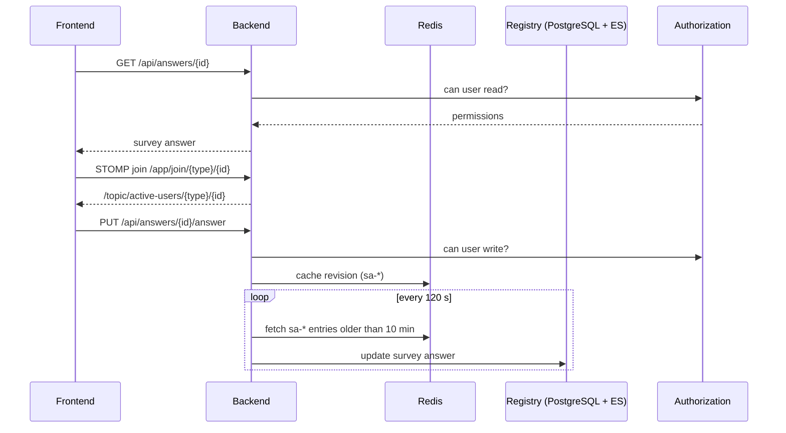

# EOSC Observatory Backend — Integrations

This document describes which components the EOSC Observatory Backend communicates with, and why.
Configuration keys refer to `src/main/resources/application.properties`; see the file for defaults.

## Overview

| Component | Direction | Purpose | Protocol | Configuration | Evidence |
|---|---|---|---|---|---|
| Observatory frontend | Inbound | All user-facing operations | REST (JSON), STOMP over SockJS | `ws.allowedOriginPattern`, `observatory.*` | `controller/*`, `websockets/WebSocketConfig.java` |
| OIDC identity provider | Outbound | User login and logout | OpenID Connect | `spring.security.oauth2.client.*` | `configuration/security/SecurityConfig.java` |
| PostgreSQL | Outbound | Registry, permissions, comments, datasets, erasure register | JDBC | `registry.datasource.*`, `authorization.datasource.*`, `commenting.datasource.*`, `datasets.datasource.*`, `erasure.datasource.*` | `src/main/resources/application.properties`, `commenting/CommentingDatasourceConfig.java`, `datasets/DatasourceConfig.java`, `erasure/ErasureDatasourceConfig.java` |
| Elasticsearch | Outbound | Search index for registry resources | HTTP | `registry.elasticsearch.*` | `pom.xml` (`registry-starter-elasticsearch`), `application.properties` |
| Redis | Outbound | Sessions, survey-answer cache | Redis | `spring.data.redis.*` | `pom.xml` (`spring-session-data-redis`), `service/RedisCacheService.java` |
| Mailer | Outbound | Email delivery | REST (`POST {host}/mails` through `ResilientMailer`) | `mailer.client.*`, `mailer.retry.*`, `mailer.from` | `configuration/MailerConfig.java`, `messaging/mailer/ResilientMailer.java`, `configuration/MailDebugConfig.java` |
| Messaging system | Outbound | Threads and messages between users and groups, user erasure | REST (`messaging-client` `0.1.1-SNAPSHOT`) | `messaging-system.client.*` | `messaging/MessagingSystemController.java`, `service/UserServiceImpl.java#purge` |
| Statistics tool | Outbound | Indicator data for charts | HTTP GET | `stats-tool.endpoint`, `stats-tool.query-access[*]` | `statistics/StatsToolWrapperController.java`, `statistics/StatsQuerySecurity.java` |
| Matomo | Outbound | Page-view analytics | HTTP | `analytics.url`, `analytics.token` | `controller/AnalyticsController.java` |
| OpenAI | Outbound | Document generation | HTTPS (Spring AI through `document-analyzer` `1.1.0`) | `spring.ai.openai.*` | `resources/analyzer/SurveyAnswerDocumentAnalyzer.java` |
| Websites referenced in survey answers | Outbound | Fetch documents for generation | HTTP(S), headless Chromium (`document-analyzer`) | — | `resources/analyzer/SurveyAnswerDocumentAnalyzer.java`, `Dockerfile` (Playwright) |
| Google reCAPTCHA | Outbound | Bot protection on the public messaging-thread endpoint | HTTPS (`recaptcha` `1.0.0`) | `google.recaptcha.*` | `configuration/ObservatoryConfig.java` (`@EnableReCaptcha`), `messaging/MessagingSystemController.java` (`@ReCaptcha`) |
| Sentry | Outbound | Error and performance reporting | HTTPS | `sentry.*` | `pom.xml` (`sentry-spring-boot-starter-jakarta`, `sentry-log4j2`) |

The `registry`, `catalogue` and `authorization` projects are linked into the application as libraries.
Calls to them are in-process; their only network connections are the PostgreSQL and Elasticsearch
connections above.

## Inbound

### Frontend (REST)

- Base path: `http://<host>:8280/api` (`server.servlet.context-path=/api`).
- Authentication: session cookie obtained through the OIDC login flow. The frontend initiates login via
  the standard Spring Security OAuth2 endpoints and is redirected to `observatory.login-redirect`.
- CSRF: state-changing requests must send the token in `X-XSRF-TOKEN`. The token is available from the
  `XSRF-TOKEN` cookie and from `GET /csrf`.
- Anonymous access is allowed by the URL filter; individual endpoints are protected with method-level
  checks (see [architecture.md](architecture.md#authentication-and-authorisation)).
- Errors are mapped by `ExceptionControllerAdvice`. Sensitive fields configured under `privacy.*` are
  redacted from responses.
- Cross-origin access: `SimpleCORSFilter` sends credentialed CORS headers only to the origins in
  `observatory.corsAllowedOrigins`. It allows `GET`, `POST`, `DELETE` and `OPTIONS` and doesn't list
  `X-XSRF-TOKEN`, so serve the frontend from the same origin (for example behind one reverse proxy).
- Reference: Swagger UI at `/api/swagger-ui/index.html`, OpenAPI JSON at `/api/v3/api-docs`.

### Frontend (WebSocket)

- Endpoint: `/api/websocket` (SockJS, STOMP). Allowed origins: `ws.allowedOriginPattern`.
- Application prefix `/app`; broker topics under `/topic`.
- The handshake validates the CSRF token; the endpoint requires an authenticated session.

| Purpose | Client sends to | Client subscribes to |
|---|---|---|
| Presence | `/app/join/{type}/{id}`, `/app/leave/{type}/{id}`, `/app/focus/{type}/{id}/{field}` | `/topic/active-users/{type}/{id}` |
| Concurrent edit | `/app/edit/{type}/{id}` | `/topic/edit/{type}/{id}` |
| Survey-answer comments | `/app/comments/survey_answer/{targetId}[/{threadId}[/messages[/{messageId}]]]` (plus `/resolve` and `/delete` variants) | `/topic/comments/survey_answer/{targetId}` (deletions on `.../delete`) |
| Inbox | `/app/messages/inbox/unread/{userId}` | `/topic/messages/inbox/unread/{email}`, `/topic/messages/inbox/notification/{email}` |

## Outbound

### OIDC identity provider

Authenticates users (authorization-code flow through `spring-boot-starter-oauth2-client`). The email
claim identifies the user throughout the application and decides `ADMIN` status via
`observatory.admins`. Logout is RP-initiated and returns to `observatory.logout-redirect`. The client
registration is not defined in the shipped properties and must be supplied per environment.

### Mailer

Emails (survey notifications, answer validation, invitations, message and comment notifications) are
built from FreeMarker templates and posted to `{mailer.client.host}/mails` by `ResilientMailer`, using
`mailer.from` as the sender. Recipients are placed in BCC, and each user's notification preferences
(opt-out, forwarding addresses) are applied first.

- Sent synchronously on the calling thread, with a connect timeout of `mailer.client.connect-timeout`
  (3 s) and a read timeout of `mailer.client.read-timeout` (30 s).
- Connection failures and `5xx` responses other than `502` are retried up to `mailer.retry.max-attempts`
  (5) times, `mailer.retry.delay` (1 s) apart. Read timeouts, `4xx` and `502` (SMTP delivery failed)
  are not retried, since the mail may already have reached some recipients.
- After the last attempt it throws `MailDeliveryException`. Every caller catches it and logs.
- When `mailer.client.api-key` is set, it's sent as `X-API-Key`.
- With the default `mail-debug` profile, a stub replaces the mailer. It logs masked addresses and
  keeps the messages in memory.

### Messaging system

`MessagingSystemController` extends the `messaging-client` controller and delegates thread and message
storage to the remote service at `messaging-system.client.endpoint`. The client is built on the
application's `WebClient.Builder` and sends `messaging-system.client.api-key` as `X-API-Key` when set.
The backend:

- Authorises every operation, because the messaging service doesn't authorise users. Reads and
  searches need membership of the requested group. New threads need the user's own email as sender and
  membership of the sender group. Read receipts need the user, or one of their groups, to take part in
  the thread. Thread updates and deletions need `ADMIN`. The user's identity always comes from the
  session.
- Resolves group recipients to users, sends email notifications, and pushes unread counts and
  incoming-message notifications to connected WebSocket users.
- Erases a purged user from the messaging service (`anonymizeUser`, waiting up to a bounded timeout).

### Statistics tool

`GET /api/statistics/raw?json=<query>` forwards the query to `stats-tool.endpoint` (`raw` path). Before
forwarding, `StatsQuerySecurity` matches the query against `stats-tool.query-access[*]`: queries marked
`open` are allowed for everyone, and `restricted` queries require membership of the listed groups. Errors
returned by the tool are logged and surfaced as a runtime error.

### Matomo analytics

`GET /api/analytics/pageviews` and `/api/analytics/pageviews/{path}` call the Matomo reporting API at
`analytics.url`, authenticated with `analytics.token`, once or twice per requested month, and aggregate
page views per month (optionally for one country). Both properties are read without defaults, so the
application will not start if they are absent.

### OpenAI

`POST /api/resources-registry/generate` (admin) starts asynchronous document generation. For each answer
the backend extracts document URLs, sends them with a template to the model configured in
`spring.ai.openai.chat.options.model` through the `document-analyzer` library, and stores the result as
a `document` resource. A document is regenerated when its recorded model differs from the configured
one. The API key is `spring.ai.openai.api-key`; the shipped value is a placeholder.

### reCAPTCHA

Enabled with `@EnableReCaptcha` and applied with `@ReCaptcha` to the public thread creation endpoint of
`MessagingSystemController`. The token is read from the `g-recaptcha-response` header and verified
against `google.recaptcha.url` with a score threshold of `google.recaptcha.threshold` (v3).

### PostgreSQL, Elasticsearch and Redis

Connection settings are described in [architecture.md](architecture.md#persistence). If Elasticsearch
or Redis is unavailable the dependent features (search, sessions, answer caching) fail; the backend
does not provide fallbacks for them.

## Flow: editing a survey answer

Source: [diagrams/data-flow.mmd](diagrams/data-flow.mmd)

## Error, retry and timeout behaviour

- Permission assignment after survey-answer creation is retried up to 5 times with a 5 s delay
  (`@Retryable` on `PermissionsUpdateAspect`).
- Failures flushing a cached survey answer are logged and skipped. The next scheduler run tries again.
- Mail: timeouts and retries as described above. Failures are logged per message and don't stop the
  caller.
- Messaging system: connect timeout `messaging-system.client.connect-timeout` (10 s) and response
  timeout `messaging-system.client.response-timeout` (30 s), no retries.
- No explicit timeouts or retries are configured for the statistics tool, Matomo or OpenAI clients.
  The defaults of the underlying HTTP clients apply.

## Cross-check with dependency documentation

These are relationships reconciled against the documentation of the dependency repositories. Those
analyses describe the newer versions under "Analysed there". The observations describe the versions
pinned here, checked against this application's code and configuration.

| Dependency | Pinned here | Analysed there | Observation from this side |
|---|---|---|---|
| registry | 4.3.1 | 4.3.2-SNAPSHOT | Embedded with the Elasticsearch starter, without JMS. The registry REST controllers are exposed under `/api`, with `/version/**`, `/schemaService/**`, `/resourcesync/**` and the admin paths restricted to `ADMIN` (see [security-model.md](security-model.md)) |
| catalogue | 9.1.0 | 9.1.2-SNAPSHOT | `/logs/**`, `/forms/**` (non-GET) and `/items/**` are `ADMIN`. `POST /request/default` needs login |
| authorization | 2.1.0-SNAPSHOT | 2.1.0-SNAPSHOT | Separate `permissions` database configured explicitly (`authorization.datasource.*`), `hbm2ddl.auto=update`. The host's other datasources are declared as explicit named beans |
| mailer-client | 0.0.2-SNAPSHOT (no matching tag) | 0.1.1-SNAPSHOT | Only the API types are used. `ResilientMailer` posts to `/mails` and sends the mailer's optional `X-API-Key`. The mailer answers `502` when SMTP delivery fails |
| messaging-client | 0.1.1-SNAPSHOT | 0.1.1-SNAPSHOT | This application adds the authorisation the messaging service lacks: each inherited endpoint is overridden with `@PreAuthorize` group-membership, sender or participant checks, and the public thread endpoint is reCAPTCHA-protected. The client sends the service's optional API key. Search text is matched literally by the service |
| document-analyzer | 1.1.0 | 1.1.1-SNAPSHOT | Fetches URLs found in survey answers server-side. Chromium runs inside this container |
| recaptcha | 1.0.0 | 1.0.1-SNAPSHOT | Threshold `0.7`, v3. The token comes from the `g-recaptcha-response` request header through a SpEL argument |
