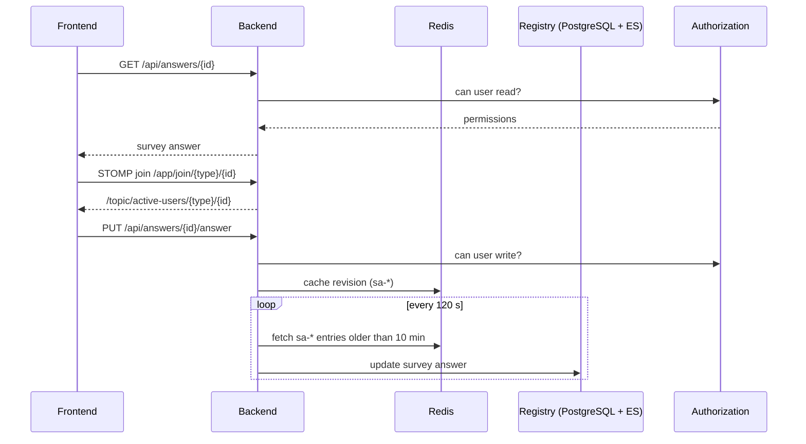

# Integration

This document describes which components the EOSC Observatory Backend communicates with, and why.
Configuration keys refer to `src/main/resources/application.properties`; see the file for defaults.

## Overview

| Component | Direction | Purpose | Protocol | Configuration |
|---|---|---|---|---|
| Observatory frontend | Inbound | All user-facing operations | REST (JSON), STOMP over SockJS | `ws.allowedOriginPattern`, `observatory.*` |
| OIDC identity provider | Outbound | User login and logout | OpenID Connect | `spring.security.oauth2.client.*` |
| PostgreSQL | Outbound | Registry, permissions, comments, datasets | JDBC | `registry.datasource.*`, `authorization.datasource.*`, `commenting.datasource.*`, `datasets.datasource.*` |
| Elasticsearch | Outbound | Search index for registry resources | HTTP | `registry.elasticsearch.*` |
| Redis | Outbound | Sessions, survey-answer cache | Redis | `spring.data.redis.*` |
| Mailer | Outbound | Email delivery | REST (`mailer-client`) | `mailer.client.host`, `mailer.from` |
| Messaging system | Outbound | Threads and messages between users and groups | REST (`messaging-client`) | `messaging-system.client.endpoint` |
| Statistics tool | Outbound | Indicator data for charts | HTTP GET | `stats-tool.endpoint`, `stats-tool.query-access[*]` |
| Matomo | Outbound | Page-view analytics | HTTP | `analytics.url`, `analytics.token` |
| OpenAI | Outbound | Document generation | HTTPS (Spring AI via `document-analyzer`) | `spring.ai.openai.*` |
| Google reCAPTCHA | Outbound | Bot protection on the public messaging-thread endpoint | HTTPS | `google.recaptcha.*` |
| Sentry | Outbound | Error and performance reporting | HTTPS | `sentry.*` |

The `registry`, `catalogue` and `authorization` projects are linked into the application as libraries.
Calls to them are in-process; their only network connections are the PostgreSQL and Elasticsearch
connections above.

## Inbound

### Frontend (REST)

- Base path: `http://<host>:8280/api` (`server.servlet.context-path=/api`).
- Authentication: session cookie obtained through the OIDC login flow. The frontend initiates login via
  the standard Spring Security OAuth2 endpoints and is redirected to `observatory.login-redirect`.
- CSRF: state-changing requests must send the token in `X-XSRF-TOKEN`. The token is available from the
  `XSRF-TOKEN` cookie and from `GET /csrf`.
- Anonymous access is allowed by the URL filter; individual endpoints are protected with method-level
  checks (see [architecture.md](architecture.md#authentication-and-authorisation)).
- Errors are mapped by `ExceptionControllerAdvice`; sensitive fields configured under `privacy.*` are
  redacted from responses.
- Cross-origin access is handled by `SimpleCORSFilter`, which echoes the request `Origin` and allows
  credentials.
- Reference: Swagger UI at `/api/swagger-ui/index.html`, OpenAPI JSON at `/api/v3/api-docs`.

### Frontend (WebSocket)

- Endpoint: `/api/websocket` (SockJS, STOMP). Allowed origins: `ws.allowedOriginPattern`.
- Application prefix `/app`; broker topics under `/topic`.
- The handshake validates the CSRF token; the endpoint requires an authenticated session.

| Purpose | Client sends to | Client subscribes to |
|---|---|---|
| Presence | `/app/join/{type}/{id}`, `/app/leave/{type}/{id}`, `/app/focus/{type}/{id}/{field}` | `/topic/active-users/{type}/{id}` |
| Concurrent edit | `/app/edit/{type}/{id}` | `/topic/edit/{type}/{id}` |
| Survey-answer comments | `/app/comments/survey_answer/{targetId}[/{threadId}[/messages[/{messageId}]]]` (plus `/resolve` and `/delete` variants) | `/topic/comments/survey_answer/{targetId}` (deletions on `.../delete`) |
| Inbox | `/app/messages/inbox/unread/{userId}` | `/topic/messages/inbox/unread/{email}`, `/topic/messages/inbox/notification/{email}` |

## Outbound

### OIDC identity provider

Authenticates users (authorization-code flow through `spring-boot-starter-oauth2-client`). The email
claim identifies the user throughout the application and decides `ADMIN` status via
`observatory.admins`. Logout is RP-initiated and returns to `observatory.logout-redirect`. The client
registration is not defined in the shipped properties and must be supplied per environment.

### Mailer

Emails (survey notifications, message and comment notifications) are built from FreeMarker templates
and sent through `mailer-client` to `mailer.client.host`, using `mailer.from` as the sender. Recipients
are placed in BCC, and each user's notification preferences (opt-out, forwarding addresses) are applied
first. With the default `mail-debug` profile the mailer is replaced by a stub that only logs and keeps
the messages in memory.

### Messaging system

`MessagingSystemController` extends the `messaging-client` controller and delegates thread and message
storage to the remote service at `messaging-system.client.endpoint`. The backend adds group-membership
authorisation, resolves group recipients to users, sends email notifications, and pushes unread counts
and incoming-message notifications to connected WebSocket users.

### Statistics tool

`GET /api/statistics/raw?json=<query>` forwards the query to `stats-tool.endpoint` (`raw` path). Before
forwarding, `StatsQuerySecurity` matches the query against `stats-tool.query-access[*]`: queries marked
`open` are allowed for everyone, and `restricted` queries require membership of the listed groups. Errors
returned by the tool are logged and surfaced as a runtime error.

### Matomo analytics

`GET /api/analytics/pageviews` and `/api/analytics/pageviews/{path}` call the Matomo reporting API at
`analytics.url`, authenticated with `analytics.token`, once or twice per requested month, and aggregate
page views per month (optionally for one country). Both properties are read without defaults, so the
application will not start if they are absent.

### OpenAI

`POST /api/resources-registry/generate` (admin) starts asynchronous document generation. For each answer
the backend extracts document URLs, sends them with a template to the model configured in
`spring.ai.openai.chat.options.model` through the `document-analyzer` library, and stores the result as
a `document` resource. A document is regenerated when its recorded model differs from the configured
one. The API key is `spring.ai.openai.api-key`; the shipped value is a placeholder.

### reCAPTCHA

Enabled with `@EnableReCaptcha` and applied with `@ReCaptcha` to the public thread creation endpoint of
`MessagingSystemController`. The token is read from the `g-recaptcha-response` header and verified
against `google.recaptcha.url` with a score threshold of `google.recaptcha.threshold` (v3).

### PostgreSQL, Elasticsearch and Redis

Connection settings are described in [architecture.md](architecture.md#persistence). If Elasticsearch
or Redis is unavailable the dependent features (search, sessions, answer caching) fail; the backend
does not provide fallbacks for them.

## Flow: editing a survey answer

## Error, retry and timeout behaviour

- Permission assignment after survey-answer creation is retried up to 5 times with a 5 s delay
  (`@Retryable` on `PermissionsUpdateAspect`).
- Failures flushing a cached survey answer are logged and skipped; the next scheduler run tries again.
- Failures sending survey notification emails are logged per survey and do not stop the scheduler.
- No explicit timeouts or retries are configured for the mailer, messaging system, statistics tool,
  Matomo or OpenAI clients; the defaults of the underlying HTTP clients apply.
